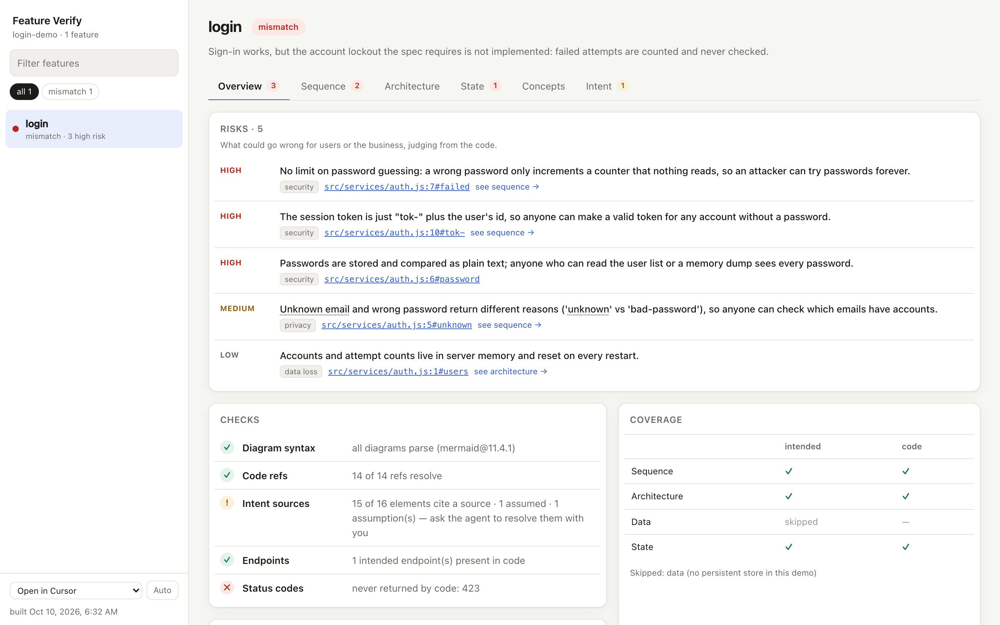
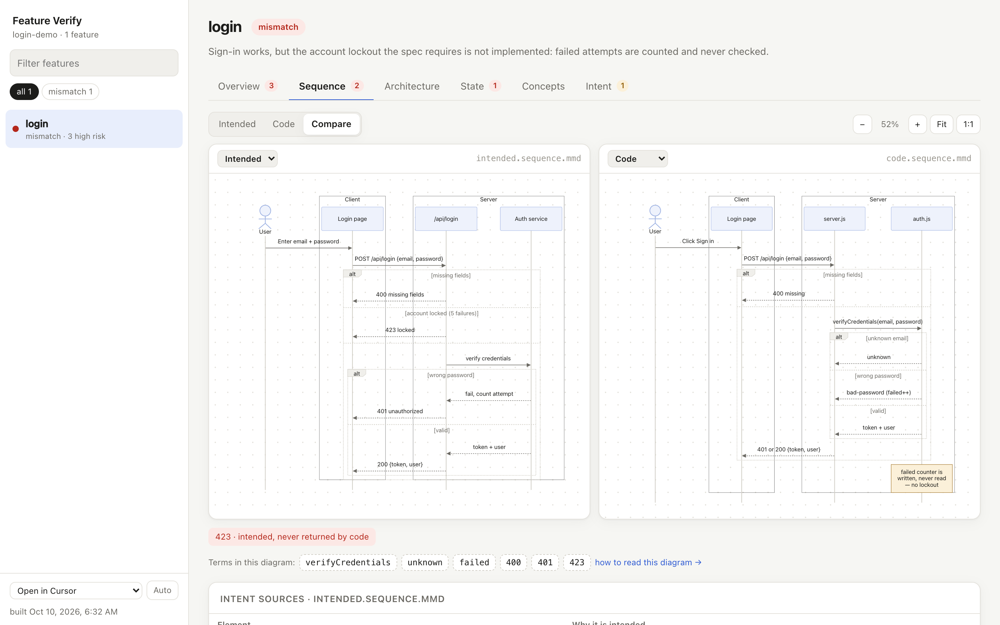
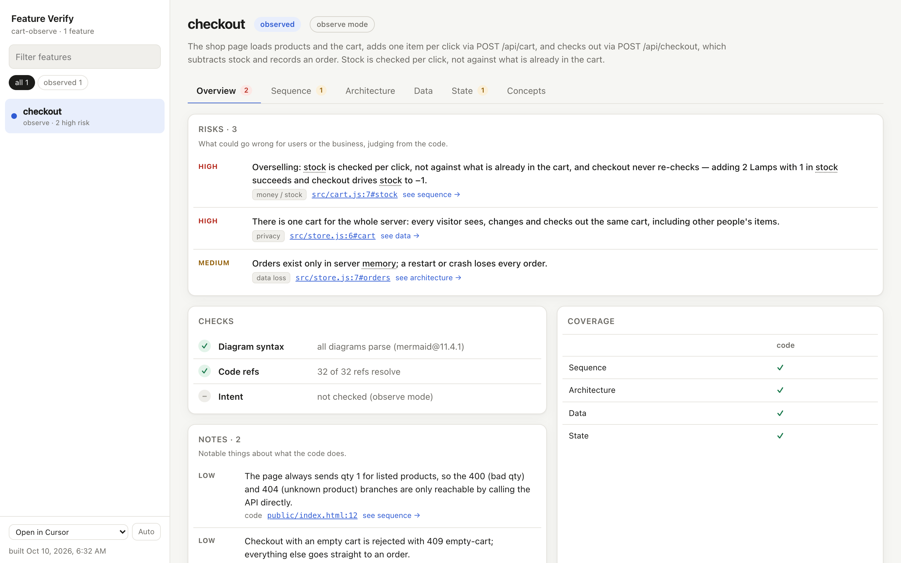

# feature-verify

Understand and verify AI-built features by looking at diagrams instead of reading every line of generated code.

For each feature, feature-verify draws diagrams from two sources and compares them:

| | made from | how it's kept honest |
|---|---|---|
| **Intended** | your own prompts to Claude Code / Codex, docs, issues, or a short interview — never the code | every element cites a source whose quote is verified; gaps become assumptions listed for you |
| **Code** | the actual code | every arrow/box carries a `file:line#symbol` ref, checked by script |

Diagram types: **sequence** (call flow + branches), **architecture** (components), **data** (entities/fields, ER), **state** (lifecycle). Differences between intended and code become findings; the feature's risks, a glossary of non-obvious terms and everything else land in a local HTML dashboard.

**It is not a testing tool.** Nothing is run or clicked — everything comes from reading the code (and your intent). The code may behave differently when it actually runs; feature-verify shows what the code says.

Works with **Claude Code** and **Codex**. Stack-agnostic: the agent reads any language.




## Modes

| mode | for | what you get |
|---|---|---|
| **verify** | "Did it build what I wanted?" | intended vs code, differences as findings, plus risks |
| **observe** | "Just show me what it does." | code only — no spec, no intent, nothing to judge against; intended diagrams are ignored even if they exist |
| **plan-first** | a feature not built yet | intended diagrams become the plan; code diagrams check it later |

`/feature-verify observe checkout`, or answer the skill's mode question. The choice can be saved per feature (`.feature-verify/<feature>/feature.json` → `{"mode": "observe"}`) or as the project default (`.feature-verify/config.json` → `{"defaultMode": "observe"}`) — useful when a project has spec docs but you only want to see what the code does.

## Install

Not published anywhere yet — install from this folder:

```
./install.sh            # copies the skill into ~/.claude/skills and ~/.codex/skills
./install.sh --link     # symlinks instead (edits in this folder apply immediately)
./install.sh --uninstall
```

Requirements: Node ≥ 18.

## Use

In any project:

```
/feature-verify                 # scan the project, list features, ask the mode, propose — writes nothing until you confirm
/feature-verify login           # full flow for one feature
/feature-verify observe login   # only what the code does
/feature-verify login code      # one step: intent | intended | code | glossary | check | verdict | dashboard
```
In Codex: "use feature-verify on the login feature".

Output goes to `.feature-verify/` in the project (you choose whether to commit it). Open `.feature-verify/index.html`.

When you run `/feature-verify`, the skill asks which mode you want (observe / verify against intent / plan first) and shows an example of each — unless you already said, or the feature or project has a saved mode.

## How it works

1. **Discover** — `discover.mjs` detects stack, frameworks, routes/pages/endpoints, schema files; `intent.mjs` counts your past prompts for the project. The agent asks the mode, proposes, and waits.
2. **Intent** (verify) — gathered from your Claude Code / Codex prompts (`intent.mjs`), docs, issues, tests, or an interview, into `intent.json`. Each source carries a verbatim quote that is checked against the file it cites. Anything unknown becomes an assumption, listed for you to answer in chat.
3. **Intended diagrams** (verify) — written from intent only; every element cites `%% @src S1` or `%% @assumed A1`.
4. **Code diagrams** — traced through the code; every element cites `%% @ref file:line#symbol`, and `check-refs.mjs` fails on any that don't exist.
5. **Glossary** — plain-language meanings of the non-obvious terms, each tied to a checked code ref.
6. **Checks** — `validate.mjs` parses every diagram with the real Mermaid parser; `compare.mjs` runs syntax, refs, glossary, intent and endpoint/status-code checks.
7. **Verdict** — the agent writes `report.json` (status, findings, risks); `dashboard.mjs` renders it and refuses to build while any diagram has a syntax error.

All scripts are plain Node, zero dependencies, and usable on their own — see headers in `skills/feature-verify/scripts/`.

### Dashboard

Feature sidebar with status filters; per feature: **Overview** (risks, differences, checks, coverage), one tab per diagram type with **Intended / Code / Compare** views (pan, zoom, fit), element tables showing where each step comes from (intent quote, or a code link that opens in your editor), **Concepts** (glossary, status codes, how to read each diagram) and **Intent** (spec, verified sources, open assumptions). Light and dark themes.

### Risks vs differences

The Overview has two lists. **Risks**: what could hurt users or the business, judging from the code — even when intent and code agree (e.g. a forgeable login token, overselling, orders lost on restart). Each links to the line it comes from. **Differences** (verify) / **Notes** (observe): where intended and code disagree, or notable facts about what the code does.

### Concepts

Diagrams use the code's own words (`qty`, `cartView`, `bad-qty`…). Each feature gets a short glossary of the **non-obvious** ones — the agent skips things everyone knows (auth, login, token, cart, 200/404…). Every term links to where it's defined in the code, and that link is checked. The **Concepts** tab shows the glossary, explains the less common status codes, and has a "how to read" legend for each diagram type; under every diagram a strip lists the terms it uses (click for the meaning), and words in the element tables show their meaning on hover.

### Opening code links

Every code ref in the dashboard is a link. Pick the editor in the sidebar (**Cursor** by default; VS Code, VS Code Insiders, Windsurf, Zed, or copy path). The choice is remembered per browser; set a project default with `.feature-verify/config.json` → `{"editor": "vscode"}`.

## Examples

Two example projects, one per mode. Build and open either dashboard:

```
cd examples/<name>
node ../../skills/feature-verify/scripts/dashboard.mjs .feature-verify && open .feature-verify/index.html
```

| example | mode | what it shows |
|---|---|---|
| [`examples/login-demo`](examples/login-demo) | **verify** | The spec (and the intent sources behind it) require locking an account after 5 failed logins; the code doesn't. Caught as status `423` missing from code and the `Locked` state absent from the code state diagram. Risks: unlimited password guessing, a forgeable token, plain-text passwords. One open assumption (A1) is listed for the user to answer. |
| [`examples/cart-observe`](examples/cart-observe) | **observe** | A shop with a `docs/SPEC.md`, deliberately **ignored** via `.feature-verify/config.json` → `{"defaultMode": "observe"}`. Code only — and reading it shows the shop **can oversell** (stock checked per click, not against the cart) and shares one cart between all visitors. |



## Privacy

`intent.mjs` reads your local Claude Code / Codex transcripts for the current project only; quoted prompts end up in `intent.json`. The dashboard loads Mermaid from jsDelivr; `validate.mjs` installs it once into `~/.cache/feature-verify/`.

## Develop

```
./tests/run.sh                         # smoke tests against the examples
claude plugin validate .               # manifest check
```

## License

MIT
